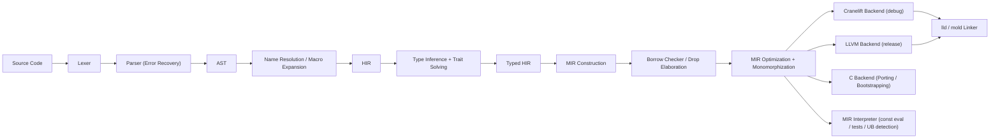
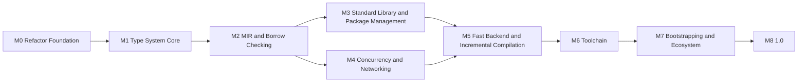

# ae Programming Language: Design Charter and Maturity Implementation Plan

Version: 0.4 (Refactored, replaces 0.3; charter, priorities, and roadmap unchanged — §5 status and §10 checklist refreshed against the working tree)
Date: 2026-11-12
Status: Prototyping (M0 partially complete; the self-hosting IR/data layer of ADR-0150–0180 is in place, the M0 crates are not). The full text of the legacy version 0.2 is backed up in `Autonomous-Programming-Language-Full-Plan.v0.2-backup.md`.

> This document covers only **goals, design rules, roadmap, and thresholds**. Granular benchmark figures, ADR details, and evidence logs are excluded from this document and are instead maintained in `ae/bench/reports/`, `ae/docs/adr/`, and `ae/CHANGELOG.md` respectively. This document is kept to a length suitable for a single reading session.

---

## 0. Documentation System

| Document | Location | Content | Update Trigger |
|---|---|---|---|
| This Plan | Desktop / `ae/docs/plan.md` | Goals, charter, roadmap, thresholds | Phase transition or direction change |
| Language Spec | `ae/spec/` | Lexical, syntax, types, ownership, concurrency, ABI rules (rules only) | Before merging each feature |
| ADR | `ae/docs/adr/NNNN-title.md` | Individual decisions: context, options, decision, evidence, rollback | Each decision |
| Benchmark Reports | `ae/bench/reports/date-topic.md` | Raw data, commands, environment, conclusions | Each measurement |
| Changelog | `ae/CHANGELOG.md` | User-visible changes between versions | Each release |
| Status Table | §9 of this doc | L0–L4 levels for each domain | Each milestone |

---

## 1. Positioning

**ae: A native programming language combining the memory safety and zero-cost abstractions of Rust with the concise syntax, concurrency model, and tooling experience of Go.**

Initial platforms: Windows x86-64 and Linux x86-64 (equal status), followed by macOS, ARM64, and Wasm.

### 1.1 Goal Priorities (Adjudicated top-down in case of conflict)

1. **Safety and Correctness**—The bottom line; cannot be traded for speed or binary size.
2. **Runtime Performance and Memory**—Benchmarked against Rust (release gap ≤ 10%).
3. **Compilation Speed**—Benchmarked against Go (cold and incremental builds in the same order of magnitude).
4. **Resource Footprint**—Artifacts, deployment dependencies, caches, and toolchain size are subject to budget constraints.
5. **General Capability and Ecosystem**—Long-term requirements, but must not compromise 1–4.

### 1.2 Benchmarks/References

Primary references: **Go, Rust**; secondary references: design concepts from Zig, Odin, Swift, Mojo, Vale, and Hylo.

### 1.3 Meaning of "Replacement"

"Replacing Go/Rust/Python" is achieved scenario by scenario. Each scenario requires: equivalent functionality, code volume no worse than Go, performance/memory no worse than Go and approaching Rust, and a toolchain/ecosystem sufficient for daily development. See §9 for the scenario list and levels; no sweeping claims are made.

---

## 2. Language Design Charter

### 2.1 Trade-off Summary

| Taken from Rust | Taken from Go | Rejected from Both |
|---|---|---|
| Ownership, move, borrow, static checks, no GC | Concise syntax, few keywords, one way to do things | Proliferation of explicit lifetimes (default inference) |
| Algebraic Data Types + exhaustive `match` | Lightweight tasks + channels + `select` | Macro system complexity (only restricted/derive macros) |
| `Result`/`Option` + `?` | Implicitly satisfied interfaces (structural trait objects) | `nil`, GC, `if err != nil` boilerplate |
| Trait + generic monomorphization | Unified toolchain build/test/fmt/doc/vet | Inheritance, exceptions, implicit conversions |
| Closures, zero-cost iterators | Fast compilation, single-file binaries | Async function coloring |
| `unsafe` boundary, FFI | Minimal Version Selection (MVS) package management | Runtime reflection (use compile-time derivation instead) |
| `Drop` deterministic release | Built-in formatting and testing conventions | Header files, forward declarations |

### 2.2 Ten Hard Rules

1. **Implement Once, Use for Any Type**: Containers, result types, and iterators must be implemented as generics at the language/standard library level; **prohibited** to add hand-written container families per element type or pre-defined result enums.
2. **Minimal Built-ins**: The compiler only retains primitives that cannot be expressed in the language (memory, arithmetic, syscall bridges); everything else goes into standard library modules, invoked via method syntax.
3. **Safe Defaults to Static**: Guarantees for safe code must be provided by compile-time checks; runtime checks are limited to semantic checks (bounds, overflow, divide-by-zero) and do not serve as a fallback for borrow/move.
4. **Default Lifetime Inference**: Fully inferred within functions; signatures inferred via elision rules; annotations required only when inference fails.
5. **Concurrency Without Function Coloring**: `spawn` regular functions; structured scoping ensures tasks do not outlive borrowed data.
6. **Single Error Mechanism**: `Result[T, E]` + `?` + context; `panic` is used only for invariant violations and terminates by default.
7. **Development and Release Semantics are Identical**: Optimizations must not change observable behavior (overflow and bounds checks are enabled in both modes).
8. **Pay-as-you-go**: No concurrency usage means no scheduler linked; no network usage means no network stack linked; empty program artifact size is subject to a budget.
9. **Spec-First**: Write `spec/` and positive/negative tests for every feature before implementation.
10. **Evidence-First**: Performance and safety claims must point to reproducible reports; single-platform verification is noted as "single-platform verified."

### 2.3 Syntax Preview (Target form, compilable by M1)

```text
use std::{fs, env}

struct Stat { word: String, count: i64 }

fn count(text: &str) -> Map[&str, i64] {
    var m = Map::new()
    for w in text.split_whitespace() { *m.entry(w).or_insert(0) += 1 }
    m
}

fn main() -> Result[(), Error] {
    let path = env::args().nth(1).context("Usage: wc <file>")?
    let text = fs::read_to_string(path)?
    let mut stats = count(&text).iter().map(|(w, n)| Stat { word: w.to_string(), count: n }).collect[Vec[_]]()
    stats.sort_by_key(|s| -s.count)
    for s in stats.iter().take(10) { println("{s.word:>12} {s.count}") }
    Ok(())
}
```

Concurrency form (M4):

```text
fn fetch_all(urls: &[String]) -> Vec[Result[Bytes, HttpError]] {
    task::scope(|s| {
        let handles = urls.iter().map(|u| s.spawn(|| http::get(u))).collect[Vec[_]]()
        handles.into_iter().map(|h| h.join()).collect()
    })
}

fn pipeline() {
    let (tx, rx) = channel[i64](capacity: 64)
    task::scope(|s| {
        s.spawn(move || for i in 0..100 { tx.send(i) })
        for v in rx { println("{v}") }
    })
}
```

### 2.4 Type System Inventory (1.0 Scope)

- Scalars: `i8..i128`, `u8..u128`, `isize/usize`, `f32/f64`, `bool`, `char`, `()`, `!`.
- Composites: Tuples, fixed-size arrays `[T; N]`, slices `&[T]`, `str`/`String`, structs, enums, unions (unsafe only).
- References: `&T`, `&mut T`, raw pointers `*const T`/`*mut T` (unsafe).
- Generics: Type parameters, const generics, trait bounds, `where` clauses, associated types, default methods, generic impls, trait objects `dyn Trait`.
- Auto traits: `Copy`, `Send`, `Sync`, `Sized`; Derives: `Clone`, `Eq`, `Ord`, `Hash`, `Debug`, `Display`, `Default`, `Serialize`.
- Operator overloading via traits; no implicit numeric conversions; integer overflow checked by default, with `wrapping_*`/`checked_*`/`saturating_*` provided.
- Patterns: Nested, guards, bindings `@`, ranges, `if let`, `let else`, `while let`.
- Closures: Inferred `Fn`/`FnMut`/`FnOnce` based on capture modes.
- Compile-time: `const fn`, compile-time evaluation (powered by the MIR interpreter), restricted derive macros.

### 2.5 Memory and Ownership Model

- Unique owners; moved-out values are inaccessible; `Copy` types are duplicated by value.
- Borrowing: Shared borrows can coexist, mutable borrows are exclusive; checking is based on **Polonius-style origin/loan dataflow** (resulting in fewer false rejections than NLL).
- `Drop` utilizes drop elaboration on MIR, covering early returns, `?`, `break`, and panic unwinding paths.
- First-class **arena/region allocation**: `Arena::scope(|a| ...)`, used for batch short-lived objects such as parsers and request handlers.
- Replaceable allocator interface; system allocator by default, with an optional built-in mimalloc-style allocator (determined by benchmarks).

### 2.6 Concurrency Model

- Automatic derivation of `Send`/`Sync`, preventing data races at compile time.
- Two-tier API: `thread::scope` (OS threads) and `task::scope` (M:N stackful coroutines with work-stealing scheduling).
- I/O: Linux epoll (io_uring optional), Windows IOCP; blocking APIs automatically yield within tasks, eliminating async/await coloring.
- Synchronization primitives: `Mutex`, `RwLock`, `Condvar`, `Atomic*`, `Arc`, `channel` (bounded/unbounded/`select`), `Once`, `Barrier`.
- Cancellation and timeouts: Structured cancellation propagates through scopes; parameterized via `deadline`.

### 2.7 Unsafe and FFI

- `unsafe { }` blocks and `unsafe fn`; documentation for every unsafe function must list its preconditions.
- `extern "C"` declarations and exports, `#[repr(C)]` layouts, callbacks, variadic functions (calling only).
- `ae bindgen` generates bindings from C headers; Python extension/embedding provided as an M7 official library.

---

## 3. Compiler Architecture



### 3.1 Principles

- **Query-based incremental compilation** (salsa style): Each phase is a cached pure function query, allowing the compiler and LSP to share the same engine.
- **Crate-level compilation units**: Crate interface summaries participate in cache keys; modifying a function body only recompiles that crate and relinks; modifying a public interface only rechecks dependent crates. (This replaces the "splitting C translation units by module" route rejected by ADR-38 in the old design.)
- **Parallelism**: Crate-level parallelism + intra-crate function-level code generation parallelism; capped by configurable thread and memory limits.
- **Multi-error recovery**: Both parsing and type checking collect multiple diagnostics, ensuring the LSP does not depend on successful builds.
- **A validator for every IR**; IR can be inspected via `ae emit --hir/--mir/--c/--asm`.

### 3.2 Code Organization (Cargo Workspace)

```text
ae/
  crates/
    ae-span        Source code, locations, diagnostics
    ae-syntax      Lexer, parser, AST, formatting
    ae-hir         Name resolution, HIR
    ae-ty          Type inference, trait solving
    ae-mir         MIR, borrow checking, optimizations, interpreter
    ae-codegen-c   C backend (migrated from existing implementation)
    ae-codegen-cl  Cranelift backend
    ae-codegen-llvm LLVM backend
    ae-driver      CLI, build system, caching, package management
    ae-lsp         Language server
  runtime/             Minimal runtime (startup, panic, allocation, platform bridge, scheduler)
  std/                 Standard library (ae source) core / alloc / std
  spec/                Language specification
  tests/ui/            Diagnostic snapshot tests (.ae + .stderr)
  tests/run/           Execution result tests (.ae + .stdout)
  bench/               Benchmark programs, runners, and reports
  docs/adr/            Architecture Decision Records
```

### 3.3 Backend Strategy

| Mode | Backend | Target | Status |
|---|---|---|---|
| `ae run` / `build --debug` | Cranelift | Compile speed comparable to Go; no user C compiler required | M5 |
| `build` (default release) | LLVM | Runtime performance comparable to Rust | M5 |
| Bootstrapping / Porting | C Backend | Rapid bring-up on new platforms, pre-bootstrap transition | Existing |

A custom native machine code backend/linker will only be considered as a separate initiative if Cranelift + lld is proven to be a bottleneck by benchmarks.

---

## 4. Standard Library and Toolchain

### 4.1 Standard Library Layering

- **core** (no allocation, no OS): primitive type methods, `Option`/`Result`, iterators, slices, `str`, formatting traits, atomics.
- **alloc**: `Box`, `Vec`, `String`, `Map` (SwissTable style), `Set`, `Deque`, `BTreeMap`, `Rc`, `Arc`, `Arena`.
- **std**: `fs`, `path`, `io` (buffered I/O, streams), `env`, `process`, `time`, `thread`, `task`, `sync`, `net` (TCP/UDP/DNS), `fmt`, `hash`, `rand`, `json`, `csv`, `regex`, `log`, `test`.
- **Official Extensions** (versioned independently): `http`, `tls`, `sqlite`, `postgres`, `serde`, `cli`, `tensor`, `gpu`, `gui`, `python`.

### 4.2 Tool Commands (Single `ae` executable)

`new` `init` `build` `run` `test` `bench` `fmt` `vet` (lint), `doc` `check` `add` `remove` `update` `publish` `cache` `clean` `emit` `version` `lsp`.

### 4.3 Package Management

- `ae.toml` manifest + `ae.lock` lockfile; dependency sources: registry, git, path.
- **Minimal Version Selection (MVS)**: deterministic results, no SAT solver required.
- Content hash verification, offline mirrors, platform-conditional dependencies, `workspace`.
- Registry: static index + object storage; signing and revocation policies.

### 4.4 Developer Experience

- LSP: diagnostics, completion, go-to-definition, references, rename, hover types, inlay hints, code actions, formatting.
- Editors: VS Code extension, tree-sitter grammar; debugging: DWARF (Linux) / CodeView+PDB (Windows), GDB/LLDB/VS compatible.
- Diagnostic quality: every error has an error code, primary label, secondary label, and fix suggestions; `ae explain E0xxx`.
- Playground: frontend compiles to Wasm, in-browser check/run via MIR interpreter.

---

## 5. Current Status Assessment (2026-11-12)

### 5.1 Existing Features (To be preserved and migrated)

- Inherent methods with `&self` auto-borrow over read-only struct borrows (ADR-0184) and `&mut self` receivers over exclusive mutable borrows with pointer field writes (ADR-0185); enum methods and `Self` (ADR-0186); generic impl blocks with per-instantiation methods (ADR-0187); by-value receivers and associated functions (ADR-0182/0183).
- **Closures** (M1.8): ADR-0188 landed closure literals with Fn/FnOnce capture inference over hidden leading parameters, borrow-capture loans, and mutation rejection; ADR-0189 landed `fn(T) -> R` parameter types over non-capturing closure pointers with indirect calls — adapter-shaped higher-order functions work; iterator adapters remain.
- **M2.2 groundwork** (new): ADR-0190 landed `ae emit-tree` — the inspectable layer above the parser, printed exhaustively over every statement/expression variant; the MIR construction can now cite tree nodes and the printer is the fixture format.
- **M2.2** (new): `emit-cfg` (ADR-0191) and `emit-mir` — the CFG and the MIR (places, rvalues, temporaries over blocks) are inspectable and validated over the whole suite.
- **M2.5** (new): the borrow checker's first three slices landed as independent verification passes over the CFG — flow-sensitive move states (ADR-0192), borrow-region liveness (ADR-0193), and write-through-borrow checks (M2.5 L3) — all agreeing with the parser across the suite.
- **M1.10** (new): nested instantiations in generic declarations (ADR-0194) — `struct Boxed[V] { inner: Pair[string, V] }` defers the shape until instantiation.
- Frontend in Rust, split across three workspace crates — `ae-span`, `ae-syntax`, and `ae-compiler` (11 frontend modules, ~340 KB total) — plus a strict C11 backend; runtime trimmed by reachability, `<windows.h>` included on-demand.
- Primitive types, structs, enums, `match`, generic functions/structs/enums, trait v1 static dispatch, modules and `pub`, `?` propagation.
- Built-ins for file/path/directory/process/env/time/JSON query; `check --json`, `fmt`, `test`, `cache`, `deps`.
- Dual-platform testing, C generation verification (`--leak`, Linux ASan/UBSan), ADR and benchmark archiving discipline.
- Frontend reuse cache for `build`/`run`: the generated C is stored per source-unit set with SHA-256 digests, and a build whose units are unchanged skips lexing, parsing, type checking, and code generation entirely (ADR-0177). Single-platform measurement in `bench/reports/2026-11-12-windows-frontend-cache.md`.
- A self-hosting IR and data layer under `std/core/` (256 modules, ADR-0150–0180): CFG/SSA form, register allocation, optimization passes, ELF64/Mach-O/PE-COFF/Wasm containers, DWARF, assembly text, linker scripts and archives, unwind tables, incremental query primitives, dependency resolution, and link-time symbol resolution, section layout and relocation application. These are structures and pure helpers; the compiler still emits C from the AST.

### 5.2 Structural Gaps (Must be resolved in M0–M2)

| Gap | Impact | Resolution Phase |
|---|---|---|
| Containers are hand-written families per element type (`vec`/`vec[string]`/`vec[f64]`/two types of map) | Linear bloat, impossible to cover arbitrary types | M1 |
| 9 built-in result enums, dozens of global built-in functions | Verbose code, namespace pollution | M1 |
| No iterators. Closures with Fn/FnOnce capture inference landed (ADR-0188); inherent methods and associated functions exist on structs and enums (ADR-0182/0183/0186), and trait methods still dispatch only through generic bounds | Expressiveness below Go/Rust | M1 (closures done; iterators next) |
| No IR, AST emits C directly | Blocks borrow checking, optimization, backend swapping. `std/core` models IR structures, but no MIR pass exists | M2 |
| Build shells out to gcc for compile and link | M5.4's 100 ms budget is unreachable: an empty program costs 96.5 ms to compile and 112.9 ms to link on the measured machine | M2/M5 |
| Borrow checking is limited rules + runtime fallback | Does not meet static safety guarantees | M2 |
| Frontend is split by module but not query-based; no LSP; multi-error recovery covers one body at a time | Blocks M5.4 and M6.1; editing feedback stays coarse | M0, M5, M6 |
| Incremental compilation exists only as value types and predicates (ADR-0176, ADR-0177); no query cache, no per-item or per-crate granularity | M5.4's four build cases cannot be verified beyond no-modification | M5 |
| Compilation speed limited by GCC | Go-level compilation speed unreachable | M5 |
| No concurrency, no networking, no package management | Missing core Go advantages | M3, M4 |

### 5.3 Corrective Decisions

1. **Immediately freeze** new built-in functions, hand-written container families, pre-defined result enums, and runtime micro-optimizations (load factors, buffer tuning, etc.) until M1 acceptance.
2. Existing built-ins will be re-implemented as standard library methods during M1; old names will be kept as deprecated aliases for one version, then removed.
3. Existing C backend will be moved into `ae-codegen-c` and switched to generate from MIR in M2.

### 5.4 Verified Progress Since Version 0.3 (2026-11-12)

These numbers are read from the working tree, not from memory: `cargo test --workspace --locked` reports 255 passing tests; `tests/run` holds 81 cases, `tests/ui` 12, `tests/ui-json` 38; `examples/` holds 42 programs; `std/core/` holds 256 modules; `docs/adr/` is numbered to 0183. CI runs the suite on `ubuntu-latest` and `windows-latest`.

Landed since the 0.3 revision:

- **Workspace split** (M0.3, partial): `ae-span`, `ae-syntax`, and `ae-compiler` exist; `ae-hir`, `ae-ty`, `ae-mir`, the three backend crates, `ae-driver`, and `ae-lsp` do not.
- **Diagnostics** (M0.4–0.5, partial): structured spans, error codes, primary/secondary labels, and `check --json`; parser recovery collects several errors within one body.
- **Method syntax** (M1.5, partial): ADR-0182/0183 landed inherent methods, associated functions, and `Type::name(...)`; ADR-0184 landed struct borrows — `&Type` parameters, `&self` receivers with auto-borrow, statement-scoped call borrows — plus two operator-aware fixes to the move check (`return l.text + "/x"` and `let b = s == t` no longer false-reject). Still open: `&mut self`, methods on enums, generic impl blocks, `Self`.
- **Test frameworks** (M0.6–0.7): `tests/ui` with `.stderr` snapshots, `tests/run` with `.stdout` snapshots, driven by `scripts/snapshots.py`.
- **CI** (M0.8, partial): dual-platform matrix and script unit tests; no dependency caching.
- **Frontend reuse cache** (new beyond 0.3): ADR-0177, with a single-platform measurement.
- **Self-hosting IR and data layer** (new beyond 0.3): ADR-0150–0180 cover CFG/SSA, register allocation, optimization passes, five object containers, DWARF, assembly text, linker scripts and archives, unwind tables, incremental query primitives, dependency resolution, and link-time symbol resolution, section layout and relocation application.
- **Build-latency budget** (new beyond 0.3): ADR-0180 measures the phases. The frontend is ~6% of a cold build (24.8 ms load, 8.5 ms emit on 1,484 lines) and 0% of a warm one; gcc is the other 94%, and an empty `hello.c` still costs 96.5 ms to compile plus 112.9 ms to link. **M5.4's 100 ms budget is unreachable through the C backend**; it needs an object-file backend and an in-process link.

Landed 2026-11-14/15: the four-way differential treats a runtime trap as agreement (exit code, stdout prefix, and trap position must match — seed 1762); `&mut` lending calls defer to the graph's ordered release walk (ADR-0205 slice 3), with the signature-table-aware release scan covering the four tables every `Expr::Call` id comes from; views bind once (slice 4 — a reassignment would break the declare-only regions, and the probe demonstrated freed-memory reads); the MIR interpreter emits runtime traps in the exact runtime format; the differential fuzzer generates the borrow surface; and CI reached its first fully green dual-platform run. The workspace suite stands at 290 passing tests, 99 run snapshots, 43 UI snapshots, 40 JSON snapshots, and the interpreter covers the run corpus except two deliberate trap cases.

What has *not* moved, and is still blocked: no concurrency, no networking, no package management, and no LSP. `unsafe`/raw pointers/`extern "C"`/`#[repr(C)]` (M2.12) are implemented — the U-matrix is closed (unsafe blocks, *const/*mut with deref and write, extern declarations and #[no_mangle] exposures with emitted prototypes, repr(C) with the c_size_of/c_offset_of query pair, E0704 precondition docs, W0702 decoration warnings, ADR-0207) — and only the 24-hour differential-fuzz acceptance (M2.13) remains for the milestone; the harness accumulates `--duration` segments (7182-seed segment 1 complete, 0 failures). Refreshed 2026-11-15 against the working tree: the "no MIR / no borrow checker / no methods / no closures / no iterators" list from the 0.4 revision is no longer true — the C backend generates from the MIR block graph (ADR-0203), borrow checking is NLL-based (ADR-0205 L1/L2: last-use regions, field-granular places, `&mut` lending calls as release sites, views bind once), inherent impls with method syntax exist (ADR-0182–0186), and closures with capture inference (ADR-0188) plus an `Iterator` trait live in `std/core`. §9 keeps the scenario levels unchanged until their acceptance gates run.

---

## 6. Implementation Roadmap (M0–M8)



Fixed process within each milestone: **Specification & Test Cases → Implementation → UI/Run Testing → Dual-platform Verification → Benchmark Report → ADR → Review for next item**.

### M0: Refactor Foundation (Zero behavior change)

| # | Step | Output | Acceptance |
|---|---|---|---|
| 0.1 | Write ADR: Design Charter (§2) and Freeze List (§5.3) | `docs/adr/0100-charter.md` | Merged |
| 0.2 | Split `docs/decisions.md` into individual ADRs; move benchmark paragraphs to `bench/reports/` | `docs/adr/*`, `bench/reports/*` | No broken links |
| 0.3 | Set up cargo workspace, split `frontend.rs` per §3.2 (mechanical move first) | Individual crates | All tests pass, all `emit-c` examples byte-for-byte identical |
| 0.4 | Unify `Span` and `Diagnostic` (error codes, primary/secondary labels, suggestions) | `ae-span` | Existing diagnostic text snapshots unchanged |
| 0.5 | Parser error recovery, type checking continues to collect errors, `check --json` outputs multiple | — | 30+ new multi-error UI test cases |
| 0.6 | UI testing framework: `tests/ui/*.ae` + `.stderr` snapshots, `--bless` to update | Test-driven | Migrate diagnostic assertions from existing integration tests |
| 0.7 | Run testing framework: `tests/run/*.ae` + `.stdout` | — | Migrate `examples/` output assertions |
| 0.8 | Clean up repo root (large files to `bench/data/`, `.gitignore`); CI dual-platform matrix + caching | CI | Green on both platforms |
| 0.9 | Standardize benchmark runner as `ae bench` prep script, fix report template | `bench/` | Generate one baseline report |

### M1: Type System Core

| # | Step | Acceptance |
|---|---|---|
| 1.1 | Specification: types, inference, traits, method resolution, patterns, closures (`spec/types.md` etc.) | Spec review passed |
| 1.2 | AST → HIR lowering; name resolution supports `impl` blocks, associated items, paths `Type::item` | UI test cases |
| 1.3 | Bidirectional type inference + unification; local variables and generic arguments inferable | `let v = Vec::new(); v.push(1)` compiles |
| 1.4 | Full integer families, `f32`, `char`, `usize`, tuples, slices, `str`/`String` separation | Positive/negative cases per type |
| 1.5 | `impl` blocks and method syntax, `self`/`&self`/`&mut self`, auto-borrow/deref | — |
| 1.6 | Trait completion: generic impls, default methods, associated types, `where` clauses, coherence (orphan rules), trait object vtables | Trait case matrix |
| 1.7 | Operator traits, `Drop`, `Clone`/`Copy`, derivation (`#[derive(...)]`) | — |
| 1.8 | Closures (capture inference) and `Iterator` trait; adapters `map/filter/enumerate/zip/take/collect` | Iterator chain performance vs. hand-written loop ≤ 5% diff |
| 1.9 | Pattern enhancement: nesting, guards, `if let`, `let else`, `while let`, exhaustiveness and reachability checks | — |
| 1.10 | Implement `Vec[T]`, `String`, `Map[K,V]`, `Set[T]`, `Option`, `Result` in the language itself; runtime retains only type-agnostic primitives | Remove `vec[f64]`, `strvec_new`, `f64map_new` etc., old names as deprecated aliases |
| 1.11 | Unified errors: `Result[T, E]`, `std::Error` trait, `.context()`; remove pre-defined result enums | All examples migrated |
| 1.12 | Formatted string interpolation `"{x:>8.2}"`, parsed at compile-time | — |
| 1.13 | Migrate all `examples/` to new syntax; write equivalent programs in Go for comparison | Avg lines of code per example ≤ Go version |
| 1.14 | Performance regression check: map/text/sum loads no worse than 10% of pre-freeze baseline | Benchmark report |

### M2: MIR and Borrow Checking

| # | Step | Acceptance Criteria |
|---|---|---|
| 2.1 | Specification: Resource Model v2 (ownership, borrows, origins/loans, drop order, two-phase borrows) | Review |
| 2.2 | MIR definition (basic blocks, Place/Rvalue/Terminator) + validator + text printer | `emit --mir` |
| 2.3 | THIR → MIR construction; C backend changed to generate from MIR | All run tests pass |
| 2.4 | Drop elaboration (including drop flags), removal of runtime null-check fallbacks | `--leak`/ASan all green |
| 2.5 | Borrow check L1: Local borrows + liveness (NLL) | All 10 categories of adversarial matrix rejected |
| 2.6 | L2: Signature lifetime elision and inference | — |
| 2.7 | L3: Inter-struct borrows, explicit `'a` | — |
| 2.8 | L4: Two-phase borrows, reborrows, split borrows (field-level) | — |
| 2.9 | L5: Closure capture borrow checking; Polonius-style origin calculation | Port and rewrite typical Rust borrowck UI use cases |
| 2.10 | MIR optimizations: Constant propagation, dead code, inlining, bounds check elimination (proof required) | Differential testing before/after optimization |
| 2.11 | MIR interpreter: `const fn`, compile-time evaluation, UB detection mode (similar to Miri) | `ae test --interp` |
| 2.12 | `unsafe`, raw pointers, `extern "C"`, `#[repr(C)]` | FFI use cases on dual platforms |
| 2.13 | Differential fuzzing: Random program generator, comparing interp / -O0 / -O2 / ASan | 24 continuous hours without new findings |

### M3: Standard Library and Package Management

| # | Step | Acceptance Criteria |
|---|---|---|
| 3.1 | Phased implementation of `core`/`alloc`/`std` (§4.1), doc comments and doc tests | Generatable via `ae doc` |
| 3.2 | `io` buffered read/write, streaming; `fs`/`path` covering Unicode, permissions, symlinks | Platform difference documentation |
| 3.3 | `json` (derived serialization), `csv`, `regex` (in-house DFA/backtracking hybrid or bindings), `log`, `rand`, `time` | Benchmarks for each library compared against Go standard library |
| 3.4 | `ae.toml`/`ae.lock`, MVS resolution, git/path dependencies, content hashing | Dependency resolution test suite |
| 3.5 | Package-level compilation and caching: Interface summaries included in cache keys | Modifying a function body recompiles only 1 package |
| 3.6 | `ae new/add/update/publish`; registry prototype | New user completes a CLI app with 2 dependencies in 5 minutes |
| 3.7 | Real-world tools: grep, file organizer, log analyzer, CSV converter, compared against Go/Python | Report |

### M4: Concurrency and Networking

| # | Step | Acceptance Criteria |
|---|---|---|
| 4.1 | Specification: `Send`/`Sync`, scoped tasks, cancellation, memory model (adopting C++20/Rust atomic model) | Review |
| 4.2 | `thread::scope`, `Mutex`, `RwLock`, `Atomic*`, `Arc`, `Condvar` | Data race rejection test cases; Linux TSan |
| 4.3 | `channel` (bounded/unbounded/`select`) | Throughput benchmark compared against Go |
| 4.4 | M:N scheduler: Stacked coroutines, work-stealing, stack growth/segmentation strategies | Memory for 10M tasks creation ≤ Go |
| 4.5 | I/O driver: epoll / IOCP; blocking APIs automatically yield within tasks | — |
| 4.6 | `net`: TCP/UDP/DNS/timers/timeouts/cancellation | Dual-platform protocol tests |
| 4.7 | `http` 1.1 client and server; `tls` bound to rustls (C ABI) or system libraries | Echo throughput ≥ Go `net/http` 80%, memory ≤ 50% |
| 4.8 | TCP/UDP forwarding proxy example: Rules, connection statistics, graceful shutdown | 24-hour stress test without leaks |

### M5: Fast Backend and Incremental Compilation

| # | Step | Acceptance Criteria |
|---|---|---|
| 5.1 | MIR → Cranelift, generating ELF/COFF object files | All run tests green |
| 5.2 | Built-in lld-driven linking; Windows no longer requires users to install MinGW/MSVC | Out-of-the-box installation on a clean Windows machine |
| 5.3 | Debug information DWARF / CodeView | GDB/VS breakpoints functional |
| 5.4 | Query-based incremental engine (all frontend stages) | Incremental modification of a function body < 100 ms (100k-line project) |
| 5.5 | Package-level and function-level parallel code generation | Multi-core scaling efficiency report |
| 5.6 | MIR → LLVM release backend | Release benchmark gap with Rust ≤ 10% |
| 5.7 | 100k-line synthetic project compared against Go: Cold / No modification / Modify implementation / Modify interface | Same order of magnitude |

### M6: Toolchain

| # | Step | Acceptance Criteria |
|---|---|---|
| 6.1 | LSP (based on query engine) full feature set (§4.4) | Completion latency < 100 ms on a 100k-line project |
| 6.2 | VS Code extension, tree-sitter grammar | Released |
| 6.3 | `ae vet` lints, `ae bench`, coverage | — |
| 6.4 | `ae doc` site, `ae explain` | — |
| 6.5 | Wasm Playground | Available online |

### M7: Bootstrapping and Ecosystem

| # | Step | Acceptance Criteria |
|---|---|---|
| 7.1 | Rewrite compiler in ae (crate-by-crate migration, starting with syntax) | Bootstrapped compiler passes all tests, three-generation build artifacts identical |
| 7.2 | `bindgen`, Python extension/embedding, NumPy array bridge | Bidirectional examples |
| 7.3 | Official libraries: `serde`, `cli`, `sqlite`, `postgres`, Web framework | L2 for each library |
| 7.4 | Platform extensions: macOS, ARM64, Wasm, cross-compilation | CI matrix |
| 7.5 | Data & GPU: `tensor` (CPU reference implementation) → Single GPU backend pilot | Inference example compared against PyTorch |
| 7.6 | Community: RFC process, edition mechanism, security response, registry launch | — |

### M8: 1.0 Release Criteria

- Specification freeze, edition compatibility commitments; bootstrapped compiler; three-platform CI.
- No known unmitigated severe security vulnerabilities; `unsafe` audits completed.
- Public benchmarks: Compilation vs. Go, execution/memory vs. Rust/Go, real-world workflows vs. Python, all fully reproducible.
- At least 3 real-world projects (CLI, Web service, network proxy) in production use.
- Comprehensive documentation: Getting started tutorial, language reference, standard library API, migration guide (Go/Rust/Python → ae).

---

## 7. Quality and Evidence Architecture

### 7.1 Test Layering

| Layer | Content | Tools |
|---|---|---|
| Unit | Internal to each crate | `cargo test` |
| UI | Diagnostic snapshots (correct cases error-free, incorrect cases report precise errors) | `tests/ui` |
| Run | Output and exit codes | `tests/run` |
| Safety | Borrow adversarial matrix, `unsafe` encapsulation, data races | UI + TSan |
| Differential | Interpreter / Backends / Optimization levels | Fuzz generator |
| Memory | Leaks, out-of-bounds, UB | `--leak`, ASan/UBSan, MIR UB mode |
| Platform | Unicode paths, permissions, line endings, processes | Dual-platform CI |
| Performance Regression | Compilation and execution benchmarks, threshold alerts | `ae bench` + CI |

### 7.2 Benchmarking Rules

- Same machine and platform, same functionality and input, output verification; fixed toolchain version.
- Report sample size, median, and variance range; interleaved execution; archive raw data and commands.
- Compilation: Cold/no-modification/implementation-change/interface-change; measure wall-clock time, CPU time, peak memory, and binary size.
- Execution: Wall-clock time, CPU time, peak RSS, artifact and deployment size; for network, include p50/p95/p99; for GPU, include VRAM usage and transfer latency.
- Standard workloads: Empty program, file search, text processing, map counting, numeric arrays, JSON parsing, HTTP service, multi-module builds, concurrent pipelines.

### 7.3 Claims Rules (Negative List Principle)

Any public claim must simultaneously satisfy: dual-platform verification + reproducible reports + fair comparison. Specific prohibited expressions are maintained in `ae/docs/claims.md` alongside the status table and will not be listed here item by item.

---

## 8. Risks and Mitigations

| Risk | Mitigation |
|---|---|
| Scope too broad, unavailable for long periods | Strict adherence to M-sequence; each M must produce a usable version; freeze list to prevent fragmentation |
| Borrow checker false positives hindering usability | NLL first, then Polonius; collect false-positive test cases, usability as an acceptance criterion |
| Borrow checker unsoundness | Adversarial matrix + differential fuzzing + MIR UB interpreter + external audits |
| Compilation speed fails to meet targets | Cranelift + incremental queries + crate-level parallelism; budget for monomorphization bloat (shared instances, polymorphism optimization) |
| Coroutine scheduler complexity | Deliver safe concurrency via `thread::scope` first, then M:N; optional scheduler linking |
| C backend UB leaking into semantics | After M2, C backend used for bootstrapping only; template review + sanitizers |
| Cold ecosystem start | Prioritize C/Python interoperability; official libraries covering high-frequency scenarios; early launch of package manager |
| Loss of control over self-developed boundaries | Allow use of mature components like Cranelift, LLVM, lld, rustls; self-developed replacements require separate ADR and benchmarking justification |

---

## 9. Scenario Status Table (L0 Planning / L1 Example Runnable / L2 Dual-Platform Core Flow / L3 Documentation+Performance+Release Gate / L4 Production Verified)

| Scenario | Current | Target Milestone & Level | Alternatives |
|---|---|---|---|
| Language Core (Types/Generics/Traits) | L1 | M1 → L2, M8 → L4 | Go, Rust |
| Memory Safety (Static Borrowing) | L1 | M2 → L2 | Rust |
| Automation Scripts & CLI | L2 | M3 → L3 | Python, Go |
| Text/Data Processing | L1 | M3 → L3 | Python |
| Concurrency & Network Services | L0 | M4 → L2, M7 → L3 | Go |
| Network Proxy | L0 | M4 → L2 | Go, Rust |
| Compilation Speed | L1 | M5 → L3 | Go |
| Dev Tools (LSP/Debug/Pkg Mgmt) | L1 | M6 → L3 | Go, Rust |
| Systems Programming/FFI | L0 | M2 → L2, M7 → L3 | C, Rust |
| Data Science/GPU | L0 | M7 → L2 | Python |
| Desktop/Graphics | L0 | Post-1.0 | — |
| Wasm/Embedded/Mobile | L0 | Evaluate from M7 | — |

---

## 10. Immediate Action Checklist (M0 Kickoff)

Legend: ☑ done, ◐ partial (see note), ☐ not started.

1. ☑ Merge design charter ADR and freeze list (M0.1) — ADR-67, ADR-68.
2. ◐ Split ADR documentation, migrate benchmarks to the reports directory (M0.2) — `docs/adr/` is split through ADR-0208 and `bench/reports/` holds the Windows baseline and cache reports; historical measurements still live in `bench/results/`. (Refreshed 2026-11-15.)
3. ◐ Set up workspace, mechanically split frontend, byte-by-byte comparison of all examples via `emit-c` (M0.3) — three of the nine planned crates exist; `scripts/compare_emit_c.py` provides the comparison.
4. ◐ Diagnostic infrastructure and multi-error recovery (M0.4–0.5) — structured diagnostics and JSON output are in place; recovery collects several errors within one body, not across declarations.
5. ☑ UI/execution snapshot testing framework and migration of legacy tests (M0.6–0.7) — `scripts/snapshots.py`, `tests/ui`, `tests/run`.
6. ◐ Repository cleanup, dual-platform CI, baseline reports (M0.8–0.9) — the CI matrix runs green on `ubuntu-latest` and `windows-latest` including the ASan/UBSan sanitizer sweep over `verify_generated_c.py` (first fully green run 2026-11-14); since 2026-11-15 the InstaBox evaluate-2 Linux box gives direct server-side evidence (full suite, snapshots, sanitizer sweep, differential segments) recorded in `docs/platform-matrix.md`. No dependency caching. (Refreshed 2026-11-15.)
7. ☑ Begin M1.1: Type system specification — `spec/types.md`, `spec/methods_and_traits.md`, `spec/modules.md`, `spec/diagnostics.md`, `spec/closures.md`, `spec/patterns.md`, `spec/generics.md`, `spec/errors.md`, and `spec/unsafe.md` describe the implemented language; `spec/stdlib.md` and `spec/packages.md` are the M3 target specs. (Refreshed 2026-11-15.)
8. ☑ M1.2/M1.5: inherent `impl` blocks with `value.method(...)` (ADR-0182), associated functions with `Type::name(...)` (ADR-0183), `&self` receivers with auto-borrow over struct borrows (ADR-0184), `&mut self` receivers (ADR-0185), enum methods and `Self` (ADR-0186), and generic impl blocks (ADR-0187) — the receiver story is complete.

9. ◐ M2: MIR and borrow checking — the C backend generates from the MIR block graph (ADR-0203), drop elaboration (ADR-0204), NLL with field-granular places and views-bind-once (ADR-0205), bounds elision (ADR-0206), the unsafe/raw-pointer/FFI surface (ADR-0207), and the MIR interpreter over the run corpus. **M2.13 is the remaining gate**: the 24-hour differential acceptance accumulates one-hour segments with `scripts/diff_fuzz.py --duration` (segment 1: 7182 seeds; segment 2: 14257 seeds; Linux segments: 14651 clean prefix + 10896 seeds — all 0 failures through 2026-11-15; two harness defects found and fixed along the way: unbounded per-seed temp dirs on a 16G disk, and an unbounded content cache on a 3.9G tmpfs).

10. ◐ M3 groundwork: `spec/stdlib.md` (M1.10/M1.11/M3.1 target with the full built-in migration inventory), `spec/packages.md` (M3.4/M3.6 target), and ADR-0208 (self-hosted containers on raw byte buffers; tracked pointer-to-owned deferred) land before implementation per Spec-First.

Note: This document serves as a design and implementation plan and does not imply that the listed capabilities are already implemented. Actual progress is governed by the §9 status table and individual reports; the roadmap may be adjusted based on evidence, but modifications to §1.1 priorities and §2.2 hard rules must be approved via ADR.